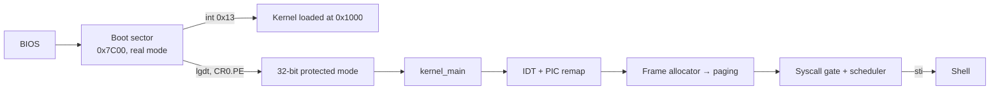

# MiniOS — an x86 Operating System from Scratch

**A minimal 32-bit x86 kernel written from the boot sector up: a 512-byte real-mode bootloader that loads the kernel and switches to protected mode, a C kernel with VGA text output, interrupt handling, a PIC-driven timer and keyboard, a physical frame allocator, two-level paging, a cooperative scheduler, an `int 0x80` syscall gate, and a tiny shell.**

The point of the project is to make every layer an OS hides visible and small enough to read: each concept lives in one or two files, with comments explaining *why* the hardware needs it.

## What's in each layer

| Layer | File(s) | What it does |
|---|---|---|
| Bootloader | `boot/boot.asm` | 16-bit real mode at `0x7C00`; reads 15 sectors of kernel via BIOS `int 0x13` to `0x1000`; loads the GDT, sets `CR0.PE`, far-jumps to 32-bit code; ends with the `0xAA55` boot signature |
| GDT | `boot/gdt.asm` | Flat model: null, ring-0 code, and ring-0 data descriptors spanning 4 GB |
| Kernel entry | `kernel/entry.asm` | `_start` stub linked first so the bootloader's jump lands on code that calls `kernel_main` |
| Console | `kernel/vga.c` | Writes character/attribute pairs to `0xB8000`; newline handling and scrolling |
| Interrupts | `kernel/idt.c`, `kernel/isr.asm` | 256-entry IDT, 32-bit interrupt gates, divide-by-zero handler |
| Hardware IRQs | `kernel/irq.c` | Remaps the 8259 PIC to vectors 32–47 (so IRQs don't collide with CPU exceptions); timer tick counter; scancode-to-ASCII keyboard echo; EOI handling |
| Physical memory | `kernel/pmm.c` | Bitmap allocator over the first 16 MB in 4 KB frames |
| Virtual memory | `kernel/paging.c` | Page directory + page tables; identity-maps 16 MB, loads `CR3`, sets `CR0.PG` |
| Scheduling | `kernel/task.c`, `kernel/switch.asm` | Round-robin `yield()`; context switch saves callee-saved registers and swaps stack pointers; new tasks start from a crafted stack frame |
| Syscalls | `kernel/syscall.c` | `int 0x80` gate with a `SYS_WRITE` dispatcher |
| Shell | `kernel/shell.c` | `help`, `clear`, `ticks`; yields while waiting for input |

## Boot sequence



## Building

Requires `nasm` and QEMU (`qemu-system-i386`).

```bash
git clone https://github.com/AliAzamat/my-own-os.git
cd my-own-os
mkdir -p build       # the Makefile writes here but doesn't create it
make                 # assembles the 512-byte boot sector into build/os.img
make run             # boots it in QEMU
```

## Status

Currently the build produces and boots **only the boot sector** — `make` assembles `boot/boot.asm` and nothing else, so the bootloader prints "Booting OS..." and then finds no kernel sectors to load. The kernel sources are written but not yet buildable:

- **No kernel build or link step.** The Makefile has no rules for compiling the C files (e.g. `gcc -m32 -ffreestanding`), assembling `kernel/*.asm` as ELF, linking at `0x1000`, or appending the kernel to the disk image.
- **Missing pieces the link needs:** `kernel/irq.h` is included but not committed; `syscall_stub` (the `int 0x80` entry) isn't defined in `isr.asm`; and the shell's `key_buffer`/`key_ready` line buffer isn't implemented by the keyboard handler. With a one-line `irq.h`, these three are the only unresolved symbols.
- **Frame allocator overlaps the kernel.** `pmm_init` reserves only frame 0, so the first frames handed to `paging_init` start at `0x1000` — where the kernel was loaded. Reserving the frames the kernel image occupies is needed before paging is enabled.
- Only the divide-by-zero exception has a handler; the `ticks` shell command doesn't print the tick count yet.
